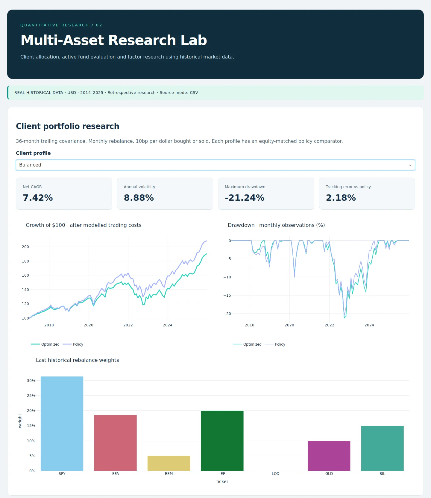

# Multi-Asset Portfolio Allocation & Active Fund Evaluation

A Python, SQL Server and Dash research project using **real historical prices** for 10 US-listed instruments. It compares constrained client portfolios, evaluates active fixed-income funds against investable benchmark proxies, measures factor exposures and tests next-month volatility forecasts.

**Research period:** January 2014–December 2025. **Backtest:** January 2017–December 2025, 108 monthly holding periods following 36 training months. This is fund-level research, not attribution to named individual managers.

## Start here

- [Research notebook: EDA, allocation, fund evaluation and forecasting](notebooks/01_multi_asset_research.ipynb)
- [Measured findings from the historical run](reports/historical_research_brief.md)
- [Windows 11 / Python 3.11 / SQL Server instructions](docs/windows_setup.md)
- [Methods and limitations](docs/methodology.md)
- [Source provenance and data handling](docs/data_sources.md)
- [Validation status](docs/validation.md)



## What is implemented

| Area | Implementation |
|---|---|
| Python / SQL data handling | Downloaded payload cache, SHA-256 provenance, duplicate and coverage checks, SQL Server primary keys, constraints, indexes and transactional upserts |
| Asset allocation | Conservative, Balanced and Growth equity budgets; CVXPY minimum variance with Ledoit–Wolf covariance and explicit exposure limits |
| Backtesting | Prior-month training only, drifting holdings, monthly rebalance, initial entry and subsequent trading costs |
| Fund evaluation | BOND/AGG and MINT/BIL comparisons, CAGR, drawdown, tracking error, information ratio and rolling 36-month metrics |
| Factor research | Statsmodels OLS with HAC inference; equity, Treasury and credit-relative exposures; descriptive Treasury-yield sensitivity |
| Time series / ML | Walk-forward OLS and Random Forest volatility forecasts compared with persistence and trailing-mean baselines |
| Dash | Portfolio and fund selectors, performance and drawdown charts, factor confidence intervals, sortable tables and a constrained allocation sandbox |
| Reports / AI | Generated executive report, quality audit and facts JSON; manual AI prompt with exact-key/type/value validation |
| Maintenance | Cached reproducible runs, explicit re-download, PowerShell refresh script, unit CI and manual historical integration workflow |

## Quick start

Python 3.11 or 3.12 is recommended. Run commands from the extracted/cloned repository root.

```bash
python -m venv .venv
# Windows: .venv\Scripts\activate
# macOS/Linux: source .venv/bin/activate
python -m pip install -e ".[dev]"
python -m multi_asset.pipeline --download
python -m pytest -q
python -m multi_asset.dashboard
```

Open **http://127.0.0.1:8051**. Port 8051 allows the separate ABS dashboard to keep using 8050. Keep the dashboard terminal open; use a second terminal for other commands.

On Windows, a short environment path such as `C:\Users\hp\portfolio-env` avoids ZIP extraction path-length issues. The [Windows guide](docs/windows_setup.md) uses the Python 3.11 installation already used for the ABS project.

Raw prices are **not bundled**. The first run requires internet access and successful Yahoo/FRED responses; the application fails explicitly if sources are unavailable. Later runs can use the verified local cache:

```bash
python -m multi_asset.pipeline
python scripts/execute_notebook.py
```

The executed notebook is saved locally to `reports/local/executed_research.ipynb`. The tracked notebook contains runnable code without embedded full data histories.

## SQL Server

Create a dedicated `MultiAssetResearch` database, install `.[sqlserver]`, set `MULTI_ASSET_SQLSERVER_URL`, and run `python -m multi_asset.database`. The loader creates the `research` schema and reconciles all loaded row counts in one transaction. Rerunning updates existing keys without adding duplicates.

Dash defaults to CSVs. Set `MULTI_ASSET_DASH_SOURCE=sqlserver` **before starting Dash** to query SQL Server instead. Tables are read at application startup; restart Dash after a refresh. See the [exact commands](docs/windows_setup.md).

## Findings, not an optimizer sales pitch

The recorded historical run found lower annual volatility for the optimized profiles, but lower CAGR and worse maximum drawdown than their matching policies. The research brief reports those trade-offs rather than asserting that optimization outperformed.

The lowest observed walk-forward volatility MAE belonged to Random Forest in this run. This is a measured comparison, not a guarantee of future superiority. No forecast is used in the allocation backtest.

## Repository map

- `src/multi_asset/`: ingestion, validation, analytics, allocation, forecasting, pipeline, Dash, SQL adapter and AI evidence validation.
- `notebooks/`: complete research walkthrough with EDA and charts.
- `sql/`: schema, indexes, allocation and leakage checks, rolling-return queries.
- `tests/`: deterministic **synthetic unit fixtures only**; production research never falls back to synthetic observations.
- `reports/`: checked-in aggregate brief and source manifest; local reports are ignored by git.
- `docs/`: setup, methodology, data dictionary and validation evidence.
- `scripts/`: notebook execution and Windows refresh automation.

## Limits

Surviving instruments were selected retrospectively. Market-price histories can be revised and are not point-in-time snapshots. Fund comparisons use ETF proxies, not official index returns; MINT has risks not captured by Treasury bills. Its benchmark alpha/beta are deliberately undefined when BIL is also the cash proxy. The credit factor is not duration-neutral. No taxes, intramonth drawdowns, market impact, FX hedges or verified manager-tenure attribution are included.

SQL Server code is supplied, but live Windows/ODBC integration must be verified on the user's machine. AI support is a manual research-review workflow, not a claimed live API integration. This is a research prototype, not investment advice or production portfolio management software.
